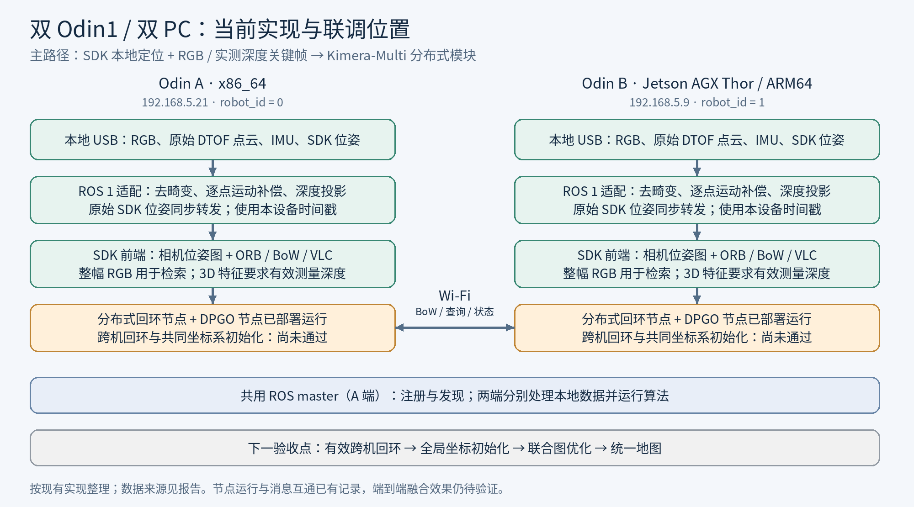
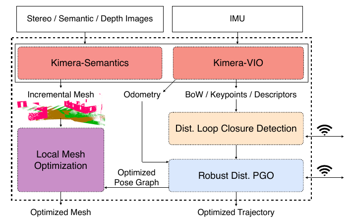
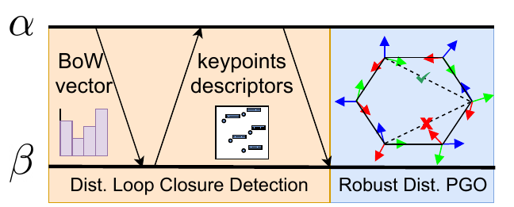
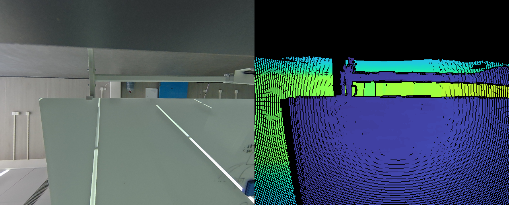
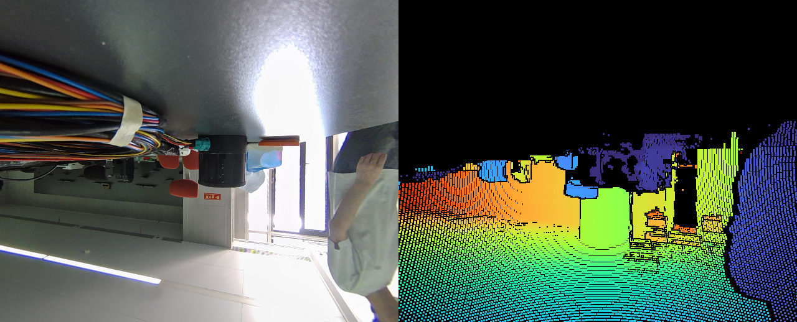
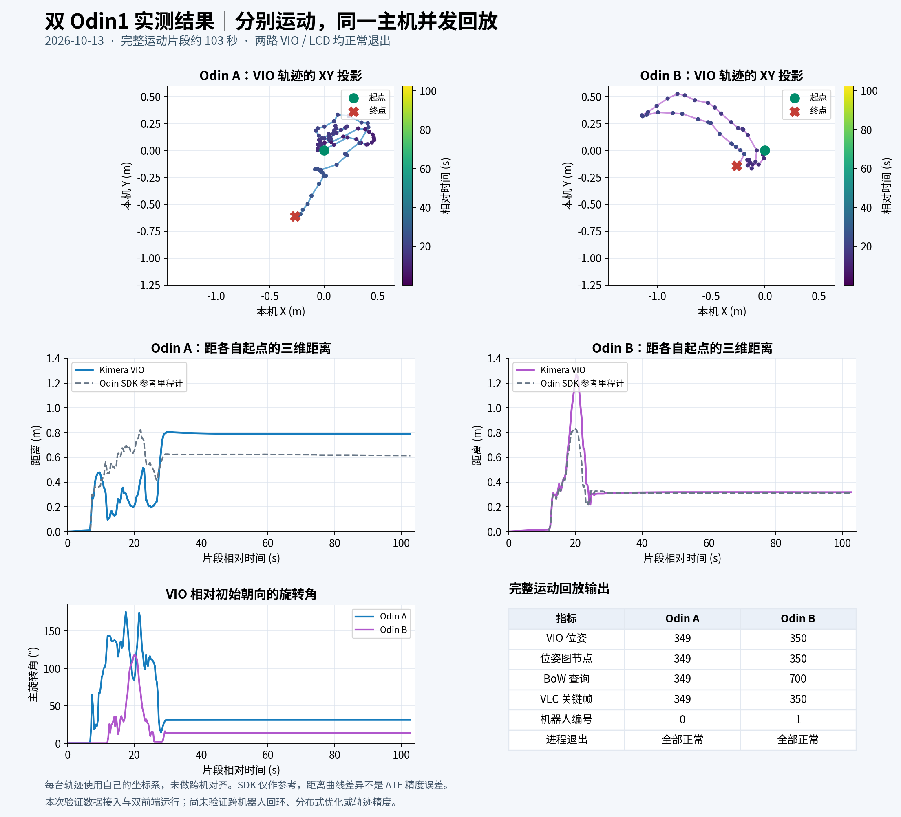
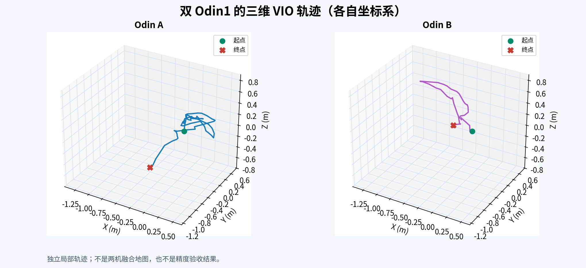
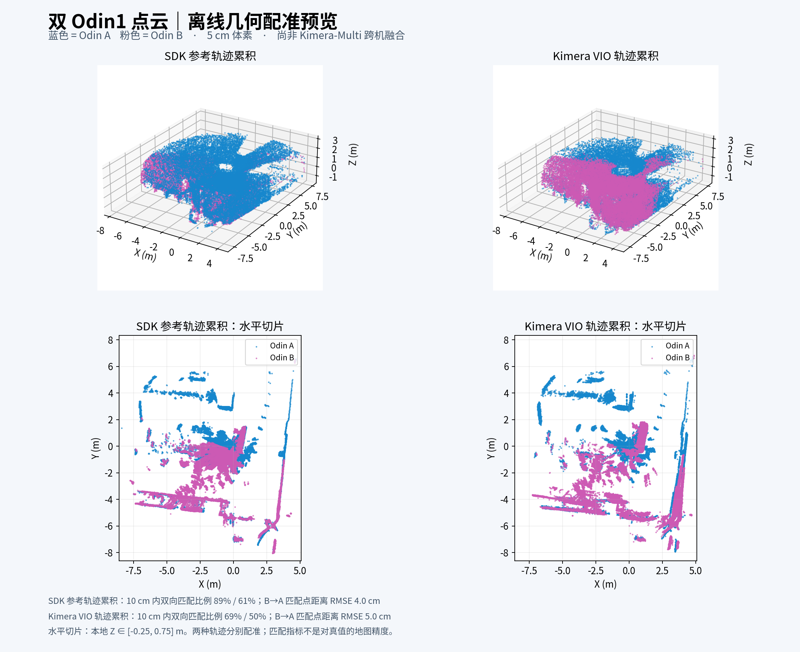
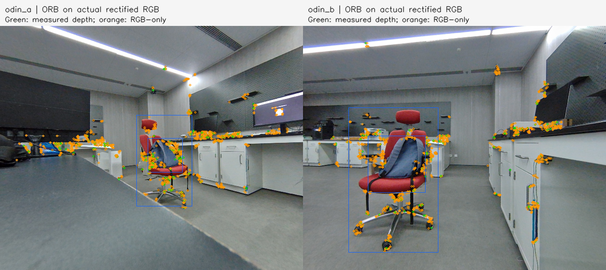
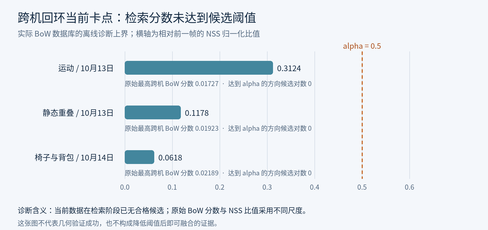

# 双机系统的进度汇报

**项目：双 Odin1 + Kimera-Multi 协同定位与建图**

**汇报日期：2026 年 10 月 15 日；实验记录更新至 10 月 14 日。**

目前已完成双设备接入、RGB-D 数据适配、SDK 本地轨迹前端，以及 x86_64 与 Jetson AGX Thor 两台 PC 的无线部署和消息互通。已有双设备运动回放、局部轨迹和离线点云配准结果。**当前处于跨机回环联调阶段：最新记录中的有效跨机回环和跨机图边均为 0，联合坐标初始化与地图融合尚未完成。**

## 1. 已完成的工作

| 模块 | 当前进展 | 验证范围 |
| --- | --- | --- |
| Odin 双设备驱动 | A/B 独立配置、命名空间、标定目录；按 USB 序列号绑定；支持 Web UI 管理 | 已有同主机双设备采集记录 |
| 数据适配 | RGB 去畸变、原始点云逐点运动补偿、相机光轴深度投影、测量有效性筛选 | 已输出 RGB-D、IMU、SDK 参考位姿，并完成录包转换与读回 |
| SDK 主前端 | 直接转发 SDK 本地位姿，生成相机位姿图、ORB 特征、BoW 词袋及 VLC 视觉关键帧 | 双路运动回放通过；另保留独立 Kimera-VIO 对照路径 |
| 双 PC 无线运行 | x86_64 与 ARM64 分别构建 ROS 1 Noetic Docker 环境；两端就地处理传感器数据 | 通信及两端前端在线检查通过；回环与 DPGO 节点已部署运行 |
| 实验可复现性 | 保留原始录包、设备标定、诊断 JSON、日志和结果图；支持仅回放原始输入重新计算 | 已完成运动、静态重叠及参考物场景测试 |
| 跨机协同建图 | 已能交换词袋并生成各自局部图，正在排查跨机候选检索与几何匹配 | 尚未得到有效跨机约束，融合验收未通过 |

工程基础来自 `/home/uros/odin`：`odin_ros_driver-main/` 为驱动，`ros2_ws/` 为 ROS 2 工作区，`calib/` 为双设备标定归档，`web_ui/` 为调试与采集面板，`captures/` 为历史录包，`wiki-master/` 和 `RTK/` 为设备及 GNSS 资料。较新的 Kimera 适配、双 PC 部署代码与测试结果位于配套目录 `/home/uros/kimeramulti`。

RTK/GNSS 已有接口、文档和采集入口；现有历史录包清单不足以证明 GNSS 数据实际接入或完成定位融合，因此本次不将 RTK 融合作为已完成成果。

## 2. 当前系统与论文算法的对应关系

*图 1：根据当前工程实现整理。绿色部分已有输入与前端验证，橙色部分为当前联调位置，底部灰色部分为下一阶段验收目标。*

两台 PC 各接一台 Odin1，分别运行驱动、数据适配、SDK 前端、分布式回环及 DPGO 节点。A 端提供共用 ROS master，用于节点注册和发现；两端通过 Wi-Fi 建立 ROS 1 TCP 连接。当前无线链路采用原生 ROS 1，主机 ROS 2 驱动链路是另一条已有调试路径。

项目主路径使用 **Odin SDK 本地定位 → 相机关键帧位姿图 → 跨机回环 → 分布式优化**。BoW 检索使用整幅 RGB 的 ORB 特征，几何验证所用的 3D 特征仍要求有效实测深度。两台设备拥有各自的时间域与 SDK 原点，需要通过有效跨机约束确定两张图的相对位姿。

*图 2：Kimera-Multi 论文 Fig. 2，原文第 4 页。展示本地定位与网格、分布式回环、鲁棒分布式位姿图优化和本地网格校正之间的关系。来源：[论文原文](https://arxiv.org/pdf/2106.14386v2)。*

对应论文架构，我们已实现 Odin 输入及 SDK 本地轨迹接入，并部署分布式回环和优化模块。论文中的语义网格、优化后的网格校正，以及完整端到端协同效果尚未验收。独立 Kimera-VIO 路径用于对照，不是当前 SDK 主前端的轨迹来源。

*图 3：同一论文 Fig. 3，原文第 4 页。两机器人先交换词袋，再按候选请求关键点和描述子，形成几何约束后进行分布式位姿图优化。来源：[论文原文](https://arxiv.org/pdf/2106.14386v2)。*

论文的鲁棒分布式优化采用 D-GNC：先建立全局坐标初始化，再交替更新轨迹与约束权重。当前最直接的前置问题是获得可靠跨机回环；仅有词袋通信与 DPGO 状态消息，还不能证明该完整流程成功。

## 3. 已跑出的测试结果

### 3.1 RGB-D 输入与运动回放

*图 4A / 4B：两设备运动片段的转换预览，左侧为 RGB，右侧为深度伪彩色。黑色区域表示无有效深度，图中深度为测量支持的投影结果。*

*图 5：2026-10-13，同一主机上并发运行两路独立 Kimera-VIO/LCD 前端的已有结果，完整录包片段约 103 秒。*

| 对照实验指标 | Odin A | Odin B |
| --- | ---: | ---: |
| VIO 输出位姿数 | 349 | 350 |
| 输出轨迹时间跨度 | 102.54 s | 102.44 s |
| VIO 距自身起点最大距离 | 0.806 m | 1.269 m |
| SDK 参考轨迹距自身起点最大距离 | 0.823 m | 0.834 m |
| 回放相关进程退出 | 正常 | 正常 |

这轮结果验证了运动数据接入和双前端并发运行。两条轨迹使用各自坐标系；SDK 位姿是参考估计，表中的距离也不是 ATE 精度误差。A 的距离曲线与 SDK 存在差异，B 的运动峰值明显大于 SDK 参考，独立 VIO 精度仍需进一步评估。[原始验证记录](双机系统进度汇报_素材/evidence/dual_device_validation.json)

*图 6：上述两路 VIO 的三维局部轨迹，分别绘制于各自坐标系。*

之后完成的 **SDK 主前端** 在同类运动回放中生成 A/B 相机图节点 **104 / 87** 个，视觉关键帧 **102 / 87** 个；已检查输出 bag。该结果与图 5 的独立 VIO 对照属于不同前端验证。[SDK 前端记录](双机系统进度汇报_素材/evidence/sdk_frontend_validation.json)

### 3.2 离线点云几何配准

*图 7：原始 DTOF 点云分别沿 SDK / VIO 轨迹累积后进行离线几何配准，蓝色为 A，粉色为 B。两种轨迹对应的点云分别拟合。*

使用 5 cm 体素、10 cm 匹配距离门限时，SDK 轨迹累积点云的 B→A / A→B 重叠比例约为 **89.4% / 60.7%**，B→A 匹配点距离 RMSE 约 **4.0 cm**；VIO 轨迹累积结果约为 **68.6% / 50.4%**、**5.0 cm**。这表明已有数据可形成局部点云并进行几何配准；这些数值是配准内部指标，不能当作对真值的建图精度，也不能替代 Kimera-Multi 跨机回环与联合优化验证。[点云实验说明与指标](双机系统进度汇报_素材/evidence/dual_device_validation.json)

### 3.3 双 PC 无线与在线前端

Wi-Fi 上的 ROS 1 双向测试发送 100 组 64 KiB 数据，全部收到，往返时延中位数 **8.03 ms**，P95 **12.79 ms**。[通信测试记录](双机系统进度汇报_素材/evidence/network_probe.json)

10 月 14 日参考物静态实验中，两端约 40 秒的前端观测结果如下：

| 指标 | A：x86_64 | B：Thor / ARM64 |
| --- | ---: | ---: |
| 原始 RGB / 点云频率 | 约 10.26 Hz | 约 10.26 Hz |
| 适配后 RGB-D 频率 | 约 10.26 Hz | 约 10.26 Hz |
| 原始 IMU / 高频 SDK 位姿频率 | 约 400.84 Hz | 约 398.20 Hz |
| RGB-D 观测条数 | 411 | 411 |
| SDK 位姿逐项对比数 | 16,038 | 15,976 |
| SDK 位姿分量最大改变量 | 0 | 0 |
| 观测窗口内新增队列溢出 / 缺少位姿失败 | 0 / 0 | 0 / 0 |
| 前端验证状态 | pass | pass |

这说明该观测窗口内输入、RGB-D 适配和 SDK 转发正常；启动预热阶段曾有队列丢帧，短时检查也不能代替长时间稳定性测试。[A 端记录](双机系统进度汇报_素材/evidence/reference_a_frontend.json)、[B 端记录](双机系统进度汇报_素材/evidence/reference_b_frontend.json)

## 4. 当前主要卡点：跨机回环

*图 8：2026-10-14，加入红色椅子与背包后的双机参考场景。绿色为有实测深度支持的 ORB 点，橙色为仅 RGB 特征，蓝框为人工近似标注的参考物区域；这些标记不表示跨机匹配成功。*

两幅图均提取 **1,200** 个 ORB 特征，但有实测深度支持的只有 **141 / 116** 个，约占 **11.8% / 9.7%**。离线快照诊断中，Hamming 双向 ratio 匹配仅得到 **4 对**，其中双方同时具有实测深度的为 **0 对**；按上游几何代码的 L1 距离方式诊断，双向匹配为 **23 对**，双方同时有深度的仍为 **0 对**。这些是离线候选匹配诊断，尚未形成实际回环。[特征统计](双机系统进度汇报_素材/evidence/reference_features.json)、[描述子诊断](双机系统进度汇报_素材/evidence/reference_descriptors.json)

*图 9：从已保存的实际 BoW 数据库重绘。三轮实验的最大跨机 NSS 比值均低于当前 alpha=0.5；原始 BoW 分数与 NSS 比值的尺度不同。原始数据：[运动](双机系统进度汇报_素材/evidence/motion_retrieval.json)、[静态重叠](双机系统进度汇报_素材/evidence/static_retrieval.json)、[参考物静态](双机系统进度汇报_素材/evidence/reference_retrieval.json)。*

最新 100 秒后端观测中，A/B 分布式图分别为 **15 节点 / 14 边**、**17 节点 / 16 边**，**跨机边均为 0，有效跨机回环为 0，融合验证为 fail**。因此，当前证据首先指向候选检索不足；稀疏深度及跨视角特征匹配也需要继续排查，尚不能将问题归因于单一模块。[最新后端记录](双机系统进度汇报_素材/evidence/reference_backend.json)

## 5. 下一阶段工作

1. **先建立可重复的跨机回环样例。** 在两机视角更接近、纹理明显且深度覆盖充足的场景录制短序列，逐级记录 BoW 候选、描述子匹配、几何内点和回环变换，明确候选在哪一步被拒绝。
2. **核对检索和几何接口。** 检查词典、ORB 描述子格式与距离度量、NSS 归一化、深度有效性以及相机外参；比较整幅 RGB 检索与早期深度区域检索的效果。阈值调整应通过独立样本评估误匹配率。
3. **完成联合图与地图验收。** 获得足够且一致的跨机约束后，检查两端全局坐标初始化、优化轨迹更新和跨机图边，再输出统一坐标系的点云/地图与优化前后对比。
4. **补稳定性与精度评估。** 做更长时间双机运动测试，统计延迟、队列与丢帧；独立校验外参和噪声参数，并引入真值或测量基准。后续再扩展独立 master、断网恢复和语义网格。

另需跟踪同主机双 USB 测试中的历史问题：USB 缓冲池曾由 16 MB 临时调至 128 MB 以缓解内存不足；设备 B 曾在 SDK 反初始化时异常退出，录包已正常落盘，但该 SDK 退出问题尚未修复。[历史问题记录](双机系统进度汇报_素材/evidence/dual_device_validation.json)

## 附：图件和资料来源

所有插图及本次引用的实验 JSON 均已复制到同级 `双机系统进度汇报_素材/`，移动或分享时请与本 Markdown 一起携带。原始图件来自配套工程的 `artifacts/dual_odin1_20261013/` 和 `artifacts/wireless/`；本次整理未重跑硬件实验，新增图 1、图 9 分别依据现有实现与归档诊断数据绘制。

论文图 2、图 3 摘自 Y. Tian 等，*Kimera-Multi: Robust, Distributed, Dense Metric-Semantic SLAM for Multi-Robot Systems*，IEEE Transactions on Robotics，38(4): 2022–2038，2022；采用 [arXiv v2 原文](https://arxiv.org/abs/2106.14386v2) 第 4 页的 Fig. 2 / Fig. 3，仅裁取图件区域，未改动内容。它们说明参考方法，不代表本项目已实现论文全部能力。

文件原始路径与校验值见 [sources.json](双机系统进度汇报_素材/sources.json)；新增流程图和诊断图可用 [regenerate_figures.py](双机系统进度汇报_素材/regenerate_figures.py) 重绘。
